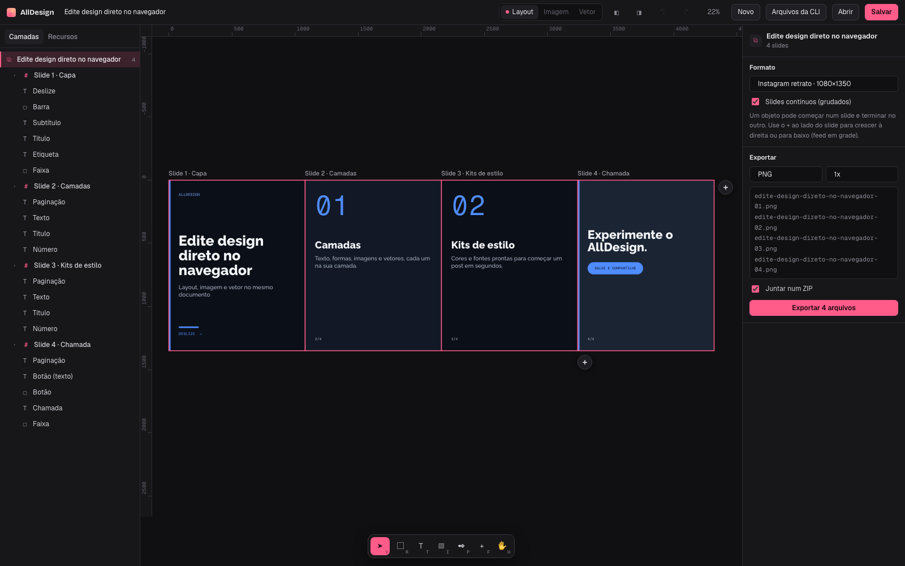
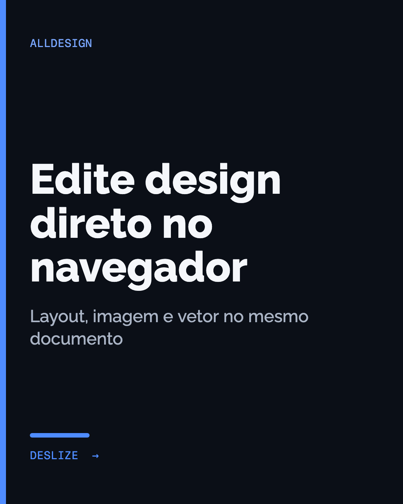
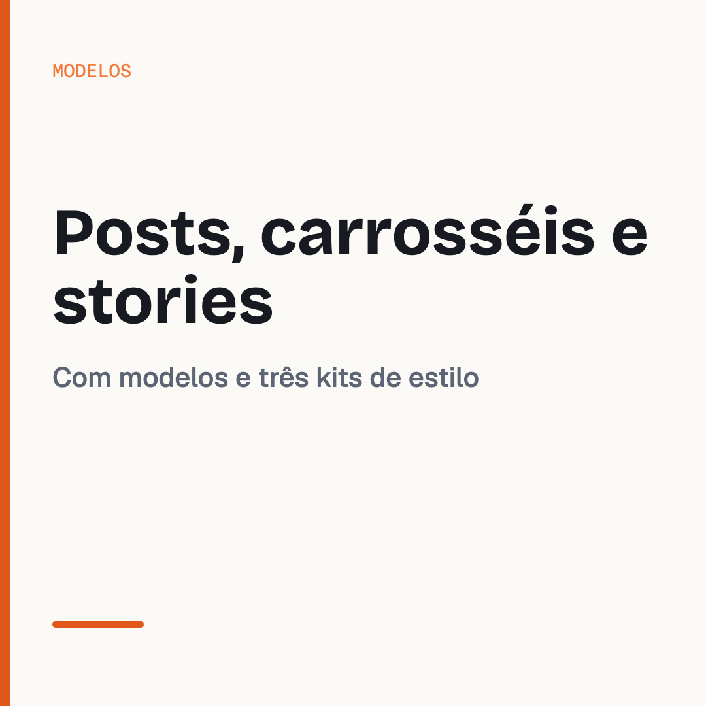
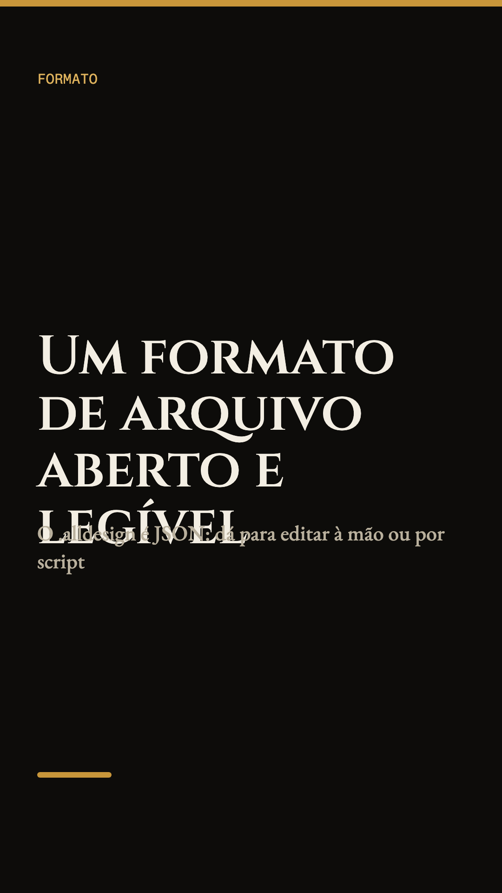

# AllDesign

Editor de design em camadas que roda no navegador, de código aberto. Três níveis de edição no mesmo documento:
**Layout** (textos, formas, imagens, slides e carrosséis), **Imagem** (ajustes e edição de pixels) e **Vetor** (caneta, curvas e operações booleanas).

> *An open-source, in-browser layered design editor: layout, image and vector editing in one document. UI and code comments are currently in Portuguese; translations and contributions are welcome.*



**Estado:** em desenvolvimento inicial (v0.0.1). Funciona, tem testes, mas a interface e o formato do arquivo ainda podem mudar.

## O que dá para fazer

- Montar posts, carrosséis e stories com modelos e três kits de estilo (escuro, claro, editorial).
- Camadas de texto (espaço entre letras, itálico, degradê), retângulos (borda, opacidade, degradê), imagens (brilho, contraste, saturação, apagar e restaurar) e vetores (caneta, alças, união, subtração, interseção).
- Efeitos: sombra, vidro fosco e desfoque (da camada, de uma área ou progressivo).
- Exportar PNG, JPG, WebP e SVG, um slide ou todos, em ZIP.
- Salvar e abrir o formato `.alldesign`: um pacote em texto (`documento.json`), legível e editável por pessoas, scripts e IAs.
- Linha de comando (`bin/design`) para criar, alterar e exportar documentos sem abrir o editor.

## Modelos incluídos

Feitos com o próprio AllDesign (`bin/design novo` + `bin/design exportar`):

| Carrossel, kit escuro | Post, kit claro | Story, kit editorial |
|---|---|---|
|  |  |  |

## Como rodar

Precisa de Node.js 22.6 ou mais novo.

```sh
npm install
npm run dev        # http://127.0.0.1:4760
npm run typecheck
npm test
npm run build
```

A exportação pela linha de comando usa o Google Chrome ou o Chromium instalado no seu computador. Se ele não for encontrado,
aponte o executável com `ALLDESIGN_CHROME`.

## Linha de comando

```sh
bin/design ajuda
bin/design novo --modelo carrossel --kit escuro --titulo "Meu título" --ponto "Primeiro|Texto do primeiro"
bin/design exportar ~/.alldesign/entrada/meu-titulo.alldesign --formato png --escala 2
```

Variáveis de ambiente: `ALLDESIGN_ENTRADA` (pasta dos arquivos criados pela CLI), `ALLDESIGN_URL` (endereço do editor) e `ALLDESIGN_CHROME`.

## Estrutura

| Pasta | O que tem |
|---|---|
| `src/motor/` | O motor: modelo do documento, comandos, renderização, vetores, imagem, efeitos, kits e modelos |
| `src/ui/` | A interface em React (camadas, painel, tela de desenho, diálogos) |
| `src/cli.ts` | A linha de comando |
| `src/exportar-headless.ts` | Exportação sem abrir o editor, via Chrome headless |
| `scripts/fontes.mjs` | Copia as fontes (Fontsource, licença OFL) para `public/fontes` |

Para criar um kit de estilo, veja `src/motor/kits.ts`. O formato do arquivo está explicado em `src/motor/leia-me.ts`.

## Contribuir

Issues e pull requests são bem-vindos. Veja o [guia de contribuição](CONTRIBUTING.md). Antes de abrir um PR, rode `npm run typecheck` e `npm test`.

## Licença

[MIT](LICENSE). As fontes incluídas pelo Fontsource têm licença OFL.
